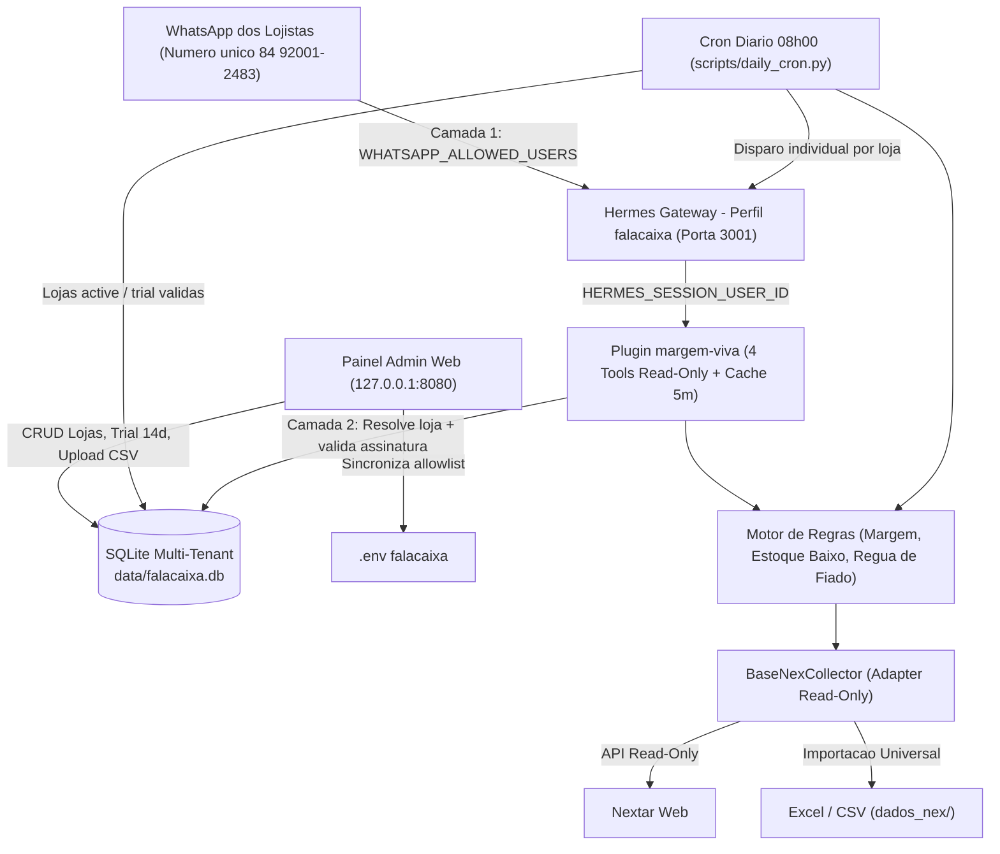
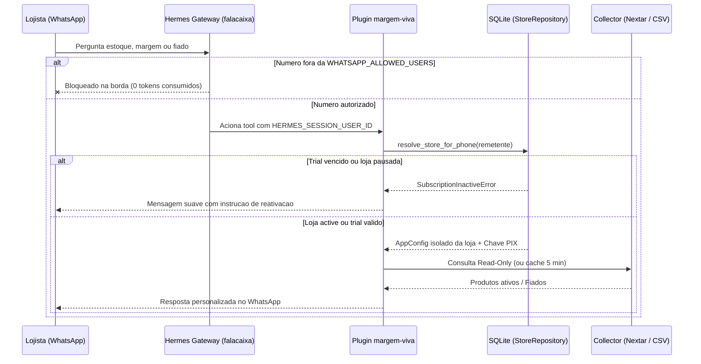

# Fala, Caixa! — Gerente Inteligente de Lucro, Estoque e Fiado no WhatsApp

O **Fala, Caixa!** é um micro-SaaS **100% Read-Only (somente leitura)** que atua como gerente financeiro e consultor 24h no WhatsApp para minimercados, mercearias e conveniências — sem exigir troca do sistema de caixa nem painéis complicados.

- **Landing Page:** [codeonthespectrum.github.io/fala-caixa](https://codeonthespectrum.github.io/fala-caixa/)
- **Branch `main`:** versão estável do piloto em produção
- **Branch `dev`:** evolução Multi-Tenant SaaS + Painel Admin

---

## System Design (Arquitetura)

O sistema foi projetado para operar com **um único número oficial de WhatsApp** atendendo múltiplas lojas com isolamento estrito de dados, custo mínimo de infraestrutura e proteção contra uso não autorizado ([ADR-0001](docs/adr/0001-isolamento-perfil-hermes-falacaixa.md), [ADR-0003](docs/adr/0003-multi-tenancy-sqlite-e-whitelist-hermes.md)).



### Fluxo de Atendimento e Isolamento Multi-Loja



---

## Modelo de Dados Multi-Tenant (`data/falacaixa.db`)

| Tabela | Responsabilidade | Campos principais |
| :--- | :--- | :--- |
| `stores` | Cadastro, ERP e assinatura de cada loja | `slug`, `store_name`, `data_source_mode`, credenciais Nextar / pasta CSV, `pix_key`, `margin_threshold`, `status` (`trial`, `active`, `paused`, `expired`), `trial_ends_at` |
| `store_users` | Números autorizados por loja (suporta sócios) | `store_id` (FK), `name`, `phone`, `role` |
| `dispatch_logs` | Auditoria dos resumos diários enviados | `store_id` (FK), `dispatched_at`, `status`, `summary` |

---

## Regras de Negócio Core

1. **Alerta de Margem Oculta (Anti-Prejuízo):**
   - Filtra apenas itens ativos em gôndola e compara a margem atual $\text{Margem} = \frac{\text{Venda} - \text{Custo}}{\text{Venda}}$ contra a meta da loja (padrão `30%`).
   - Sugere o novo preço de venda arredondado para manter a margem desejada.
2. **Alerta de Estoque Baixo (Anti-Ruptura):**
   - Monitora itens com controle de estoque ativo cujo saldo atual atingiu o estoque mínimo cadastrado.
3. **Régua de Fiado Estratificada em 3 Níveis (Anti-Calote):**
   - Avalia contas vencidas há `+30 dias` e classifica cada cliente em:
     - **Nível 1 (O Sumido):** sem compras recentes $\rightarrow$ gera mensagem individual amigável com a Chave PIX da loja pronta para encaminhar.
     - **Nível 2 (O Cara-de-Pau):** deve há `+30 dias`, mas comprou nos últimos 15 dias $\rightarrow$ alerta no topo do resumo para travar novo fiado no caixa.
     - **Nível 3 (Bom Pagador Habitual):** atraso pontual com bom histórico $\rightarrow$ lembrete suave preservando o relacionamento.

---

## Decisões Arquiteturais (ADRs)

Todas as decisões de arquitetura e trade-offs estão documentadas em `docs/adr/`:

| ADR | Decisão | Justificativa Principal |
| :--- | :--- | :--- |
| [ADR-0001](docs/adr/0001-isolamento-perfil-hermes-falacaixa.md) | Perfil isolado `falacaixa` na porta `3001` | Evitar colisão de contexto/ferramentas com outros agentes no mesmo host e reduzir latência. |
| [ADR-0002](docs/adr/0002-integracao-readonly-e-padrao-adapter.md) | Integração 100% Read-Only + Padrão Adapter | Garantir segurança total ao PDV do lojista e suportar Nextar + Excel/CSV com porta aberta para Bling/Omie. |
| [ADR-0003](docs/adr/0003-multi-tenancy-sqlite-e-whitelist-hermes.md) | SQLite Multi-Tenant + Whitelist sincronizada | Atender várias lojas em 1 único WhatsApp com isolamento estrito e zero gasto de IA com desconhecidos. |
| [ADR-0004](docs/adr/0004-painel-admin-local-e-ciclo-trial.md) | Painel Admin zero-dependência + Suspensão suave | Onboarding de novas lojas em 5 minutos (Trial 14 dias / R$ 67/mês) sem dependências extras. |
| [ADR-0005](docs/adr/0005-busca-hibrida-e-cache-em-memoria.md) | Busca semântica leve + Cache TTL 5 min | Entender abreviações naturais do varejo (`coca 2l`, `bolacha`) e responder em segundos. |

---

## Operação Local

### 1. Abrir o Painel Admin Multi-Loja
```bash
PYTHONPATH=src python3 -m nex_alerts.admin_web
```
Acesse `http://127.0.0.1:8080` para cadastrar novas lojas (Trial 14 dias), adicionar sócios autorizados, testar conexão Read-Only, subir planilhas CSV/XLSX ou disparar o resumo manualmente.

### 2. Executar o Cron Diário Multi-Loja
```bash
PYTHONPATH=src python3 scripts/daily_cron.py
```

### 3. Rodar os Testes Automatizados
```bash
PYTHONPATH=src python3 -m unittest discover -s tests -v
```
